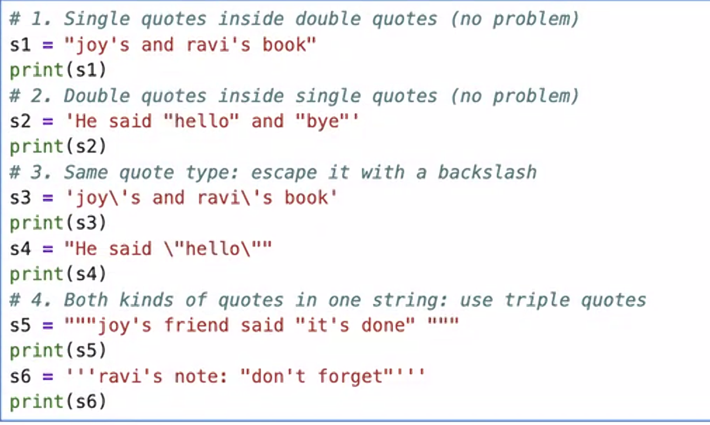

# 11/09/26 - Day 01 - Python

## What exactly is Python?  
Python is a general purpose language with a broad range of applications from statistical modeling to Gen AI and ML applications.  

## Why Python and why not SQL  
SQL is a specialized language for database manipulations, whereas python is more general purpose.  
Choose SQL is work is querying relational databases. Python is a complete programming language designed to handle logic, workflows, and advanced transformations.  

## What is a Kernel  
Basically an engine that runs the code.  

## Print Statement  

    print("Hello!") // prints Hello onto the console
    print(123) // prints 123 onto the console

## Dynamic typing  
Python will automatically determine the data types when the code is being run rather than before execution.  

## Data types  
### Integer
Numbers without a decimal / complex components.  

## Float  
Float values have a decimals.  

## Assigning a variable  

    a = 1
    b = 2

Use a variable to hold the data / store the data.  
Picks the latest assigned value  

    a = 1
    a = 2
    print(a) // prints 2

## Type casting  
1. Implicit casting  
2. Explicit casting  

### Explicit Casting  
Convert data types explicitly.  

    a = 7  
    print("Hello" + str(a)) // prints Hello7  

**str(a)** converts the data type of a from integer to a string.  

### Implicit Casting  
Python converts the data type implicitly without us having to tell it to.  

    x = 1
    print(type(x)) // prints the data type of x - int

    y = 2.323
    print(type(y)) // prints float

    z = x+y
    print(z) // 3.323
    print(type(z)) // prints str

Notice how z value which was combining an integer with a float converted both and gave out a string result?  

## Boolean Value  
True or False

    a = TRUE
    b = FALSE

    print(type(b)) // prints true  

## String Types  
There are multiple ways to represent strings in Python.  
1. Single Quote  
2. Double Quote  
3. Escape character (\\)  
4. Triple Quote  

  

Notice how if you wanted to print a type of quotes, you either had to use other types of quotes as the parent quote, or escape it using an **Escape Character (\\)** - Doing so solves unterminated string error that arises without it.  

## Naming convention for Variables  
1. Should not start w/ a number.  
2. Should not start w/ a special character.  
3. Should not use Python's built-in function names.  

If you *want* to use built in names, use an underscore before it, like:  

    _str = 2  

## Operators in Python  

Refer to <a href="operators.ipynb">operators notebook file.</a>  

## Difference between assignment operator (=) and check operators  

    == checks if the values are equal  

    != checks if the values are not equal  

    > checks if the value 1 is greater than value 2

    < checks if value 1 is less than value 2

    >= checks if the value 1 is greater than or equal to value 2

    <= checks if the value 1 is less than or equal to value 2  

## Logical Operations  

    AND --> return only if both the values are true  
    OR --> return if either value is true  
    NOT --> returns if the valus is not the value needed

## Assignment Operator  

    X = 5  
    X = -5  
    X += 5 // similar to x = x + 5

## Input

    a = int(input("Enter a value: ")) // allows users to input a value, and only accepts it, if it is an integer, erroring out if it isn't.  

## F-string  

Allows for printing values in sentences.  

    a = 54  
    x = f"I am {a} years old"

    print(x) // prints i am 54 years old  

## Dot format  

    a = "Raghava"
    b = "Cars"

    x = "I am {} and I love {}".format(a, b) // note that there is no f in front of the statement here.

Also note that the brackets can contain indexes of the values you need to place.  

    x = " I am {0} and I love {1}".format(a, b)

## Simple Expressions  

---- READ -----

## Branching  

### IF / ELIF / ELSE  

    if (condition):
        statement
    elif(condition):
        statement
    else:
        statement

Flow: checks if the condition inside IF is satisfied, if yes skips the rest of the code, or else goes to the elif statement, checks if that is satisfied, if yes it skips the rest of the code, or else it runs the code inside else if all other conditions fail.  

# 11/10/26 - Day 02 - Python  

## Loops  
A loop lets you repeat a piece of code without writing that code again and again.

Two types of loops:  
1. For loop
2. While loop  
### For loop  
Go through a collection of items or repeat something a known number of times.  

    list = ["Raghav","Arjun","Milind"]

    for i in list:
        print(i)

### While loop  
Keeps executing as long as a condition is True.  

    count = 1 // initiate a starting point  

    while count <= 5: // while this condition is true
        print(count)
        count = count + 1 // increment count value

## Range()

        for i in range(5):
            print(i)

Output: 0, 1, 2, 3, 4  

Starts at 0 and prints until just before the value entered - called **exclusive ending value**  

1. range(stop) - starts at 0 and iterates until just before the stop value.  
2. range(start,stop) - starts at the start value and stops before the stop value  
3. range(start, stop, step) - increments by step value each time as it iterates from start value to just before stop value

For example
    
    for i in range(1,5,2):

Prints 1,3,4 - 2 step increments from 1 through 5 without 5  

## Len()  
returns the length of the inner element  

    a = [1, 2, 3]
    print(len(a)) // prints out 3

## Index values

    a = [1, 2, 3]
    print(a[1]) // prints the value at index 1 of a, which is 2  

