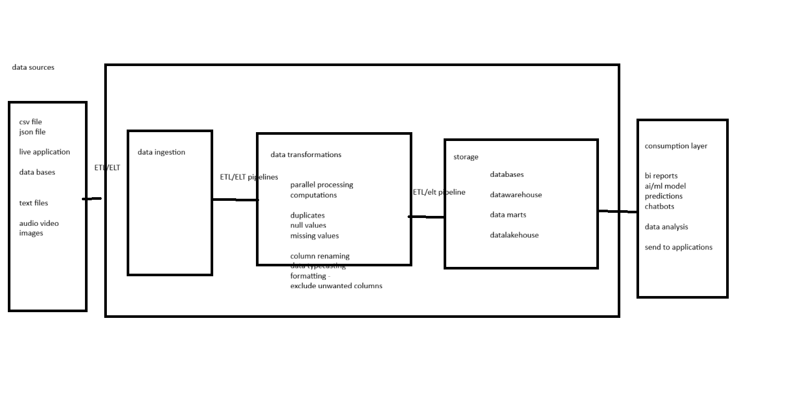

# AI-ML

So here's where it begins. Or at least I hope so. I am Raghava, and this is my version of a rough running notes for the training sessions I will be undergoing for a few weeks from now.

"Why?" The question that always bugged me, and continues to do so. Why this training?

I've been very interested in Data Engineering for the best part of the last three or so years, but something changed last week. I've been hearing the word "Forward Deployed Engineer" a little too many times lately and my curiosity made me dig deeper.
What IS an FDE, who is it for, is it even FOR me?

I tend to over-explain a lot of stuff, sometimes more than what's necessary, so I'll try to keep this notes to the minimum. I did not get in on the "AI Engineer" bandwagon two years ago, and I feel it's too late now. I always told myself that is too technical for me, I'm more of a people person. I love talking to people, trying to step into those shoes and understand their problem and then working on it. Little did I know that that was around the same ballpark as an FDE. And then it hit. What if I give myself another shot.

The AI ship appears to have sailed away, but I still have a boat to get onto and sail towards it. And honestly? It's a boat that I actually enjoy rowing.

So here's my humble attempt at unlearning what I've learnt, and streamlining my thought process. It's like learning to row the boat (FDE is the boat, if it is not yet obvious).

So here goes nothing.

## 10/22/2026 - Day 00

The classes will run for about 7.5 weeks, or about a month and a half.

Day 01 was all about introducing each other, knowing where we stand, and the basic structure of the sessions. Do I remember everyone now? Hell no. I have the memory of a squirrel. But we have an entire month and more, so I'll pick up on names.

From the little notes I managed to write, here's what will be taught:

1. **SQL** from the basics - definitions, Select statements, Joins, Subqueries, Performance tuning, etc. - here's my chance to learn and love the language again.
2. **Python** from the basics - Fundamentals, Control flow, DS, String manipulation, File handling, exception handling, List comprehensions and generators, Modules, OOP.
3. **Statistics** - Hypothesis tests, Statistical tests, A/B testing, etc.
4. **ML Models** - supervised and unsupervised learning, Regression, Decision trees, Random forest, Clustering models, SVM, KNN, etc.
5. **Natural Language Processing (NLP) and Prompt Engineering** - Processing techniques, Vector embedding, Transformer architecture, LSTM, Prompt Engineering Techniques, etc.
6. **Gen AI** - RAG, LangChain, etc.  
Detailed contents in the Google drive document.

The classes will run Monday through Friday 11:00 am CST and run for about an hour or two(give or take 30 minutes on both) - No classes on weekends.

### Assignments
1. Each session members be given some topics to prepare
2. Member has to research, learn about the topics and try to solve questions before next session.
3. In the next session, the topics will be discussed and related assignments will be given.
4. So members are expected to complete the assignments before the next session and push to GIT

## 10/23/2026 - Day 01

### What is Data?
Unstructured collection of raw numbers, facts, figures, etc.

### What is information?
Simply put, it's Data with added insights / context.  
- Data Collection
- Data Processing - to add context to the data - gain knowledge about it
- Identify patterns and make decisions based on those patterns

Data comes in three forms:
1. Structured data - data that has a schema defines - CSV, tables, etc.
2. Semi-structured data - data structured like a JSON - Web API calls, Key-value pairs, etc.
3. Unstructured data - Images, Video, PDFs, Docs, etc.

Stream Processing - Live data collection.  
Batch Processing - Collect and process data in batches - hourly / daily / weekly etc.

### Data sources
Data ingestion - Fetching data using ETL pipelines - On prem and On-Cloud

On-prem - host tool on self servers - you are responsible for orchestration, maintenance, etc.
Cloud - maintenance is taken care of by the cloud provider - AWS Glue, Azure Synapse, Informatica, etc. - Pay-as-you-go pricing

ETL has three layers: Bronze, Gold and Silver. More on that in a bit.

Bronze Layer - This is where the raw data (absolute source of truth) lives.

Where is data stored?
1. Structured data - Databases, MySQL, PostgreSQL, etc.
2. Semi-structured data - Cassandra, MongoBD, etc.,
3. Unstructured data - Dumped in Data lakehouses - Azure Blob, AWS S3 buckets, etc.

### Databases vs Data warehouses vs Data Marts
- Databases - smaller storage limits - uses internal server storage and memory
- Data warehouses - higher limits - scaling up databases when needed - here is where distributed systems and parallel processing come into view
- Data marts - a subset of data warehouses - eg. one for each department.

Silver Layer - Process the data from bronze layer - transformation of data happens here

Gold layer - Apply business logic to silver data - consumption layer

ETL vs ELT which one to use and when? depends on the infrastucture / architecture - on prem or cloud?  
  
Data Orchestration pipeline: the whole Data collection, transformation and storage from the above figure.
- Scheduling: Stream processing / batch processing - pipelines don't need to be run manually, they can be automated
- Logging - error logs, failure logs, etc.  

**Note here:** There has been a substaintial overview of the Consumption layer but my ADHD resulted in me not listening to most of it, I'll have to infer from future notes and edit that here in retrospect.  
We spoke about AI/ML models a bit, where Data Analysts come in, where Data Engineers come in, and where Data Scientists slot in. 