# AI-ML

## 10/22/2026 - Day 00

The classes will run for about 7.5 weeks, or about a month and a half.

Day 01 was all about introducing each other, knowing where we stand, and the basic structure of the sessions. Do I remember everyone now? Hell no. I have the memory of a squirrel. But we have an entire month and more, so I'll pick up on names.

From the little notes I managed to write, here's what will be taught:

1. **SQL** from the basics - definitions, Select statements, Joins, Subqueries, Performance tuning, etc. - here's my chance to learn and love the language again.
2. **Python** from the basics - Fundamentals, Control flow, DS, String manipulation, File handling, exception handling, List comprehensions and generators, Modules, OOP.
3. **Statistics** - Hypothesis tests, Statistical tests, A/B testing, etc.
4. **ML Models** - supervised and unsupervised learning, Regression, Decision trees, Random forest, Clustering models, SVM, KNN, etc.
5. **Natural Language Processing (NLP) and Prompt Engineering** - Processing techniques, Vector embedding, Transformer architecture, LSTM, Prompt Engineering Techniques, etc.
6. **Gen AI** - RAG, LangChain, etc.  
Detailed contents in the Google drive document.

The classes will run Monday through Friday 11:00 am CST and run for about an hour or two(give or take 30 minutes on both) - No classes on weekends.

### Assignments
1. Each session members be given some topics to prepare
2. Member has to research, learn about the topics and try to solve questions before next session.
3. In the next session, the topics will be discussed and related assignments will be given.
4. So members are expected to complete the assignments before the next session and push to GIT

## 10/23/2026 - Day 01

### What is Data?
Unstructured collection of raw numbers, facts, figures, etc.

### What is information?
Simply put, it's Data with added insights / context.
- Data Collection
- Data Processing - to add context to the data - gain knowledge about it
- Identify patterns and make decisions based on those patterns

Data comes in three forms:
1. Structured data - data that has a schema defines - CSV, tables, etc.
2. Semi-structured data - data structured like a JSON - Web API calls, Key-value pairs, etc.
3. Unstructured data - Images, Video, PDFs, Docs, etc.

Stream Processing - Live data collection.  
Batch Processing - Collect and process data in batches - hourly / daily / weekly etc.

### Data sources
Data ingestion - Fetching data using ETL pipelines - On prem and On-Cloud

On-prem - host tool on self servers - you are responsible for orchestration, maintenance, etc.
Cloud - maintenance is taken care of by the cloud provider - AWS Glue, Azure Synapse, Informatica, etc. - Pay-as-you-go pricing

ETL has three layers: Bronze, Gold and Silver. More on that in a bit.

Bronze Layer - This is where the raw data (absolute source of truth) lives.

Where is data stored?
1. Structured data - Databases, MySQL, PostgreSQL, etc.
2. Semi-structured data - Cassandra, MongoBD, etc.,
3. Unstructured data - Dumped in Data lakehouses - Azure Blob, AWS S3 buckets, etc.

### Databases vs Data warehouses vs Data Marts
- Databases - smaller storage limits - uses internal server storage and memory
- Data warehouses - higher limits - scaling up databases when needed - here is where distributed systems and parallel processing come into view
- Data marts - a subset of data warehouses - eg. one for each department.

Silver Layer - Process the data from bronze layer - transformation of data happens here  
Gold layer - Apply business logic to silver data - consumption layer

ETL vs ELT which one to use and when? depends on the infrastructure / architecture - on premise or cloud?  

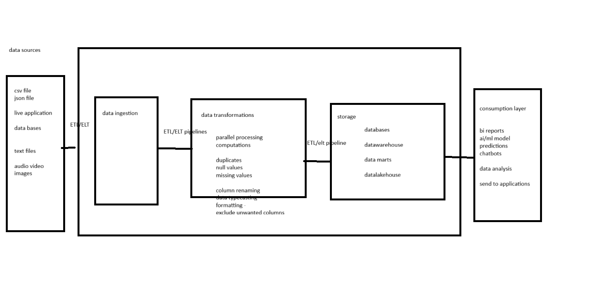

**Data Orchestration pipeline:** the whole Data collection, transformation and storage from the above figure.
- Scheduling: Stream processing / batch processing - pipelines don't need to be run manually, they can be automated
- Logging - error logs, failure logs, etc.  

**Note here:** There has been a substantial overview of the Consumption layer but my ADHD resulted in me not listening to most of it, I'll have to infer from future notes and edit that here in retrospect.  
We spoke about AI/ML models a bit, where Data Analysts come in, where Data Engineers come in, and where Data Scientists slot in.

## 10/28/2026 - Day 02

**SQL** - Structured Query Language - used to store structured data - tables  
**DB** - An organized collection of data saved on a computer  
**MySQL Server** - RDBMS that stores, organizes, and manages data using SQL  
**MySQL WorkBench** - Tool for managing and working with MySQL databases  

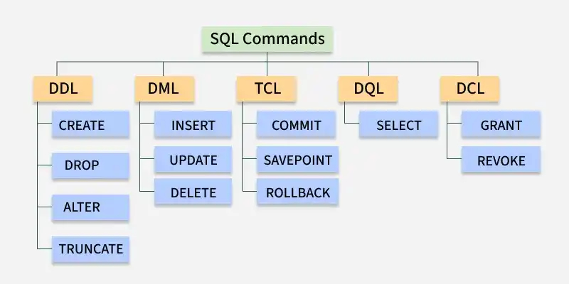  

**DDL** - Data Definition Language - used to define data - CREATE / ALTER / TRUNCATE / DROP  
**DQL** - Data Query Language - SELECT statement  
**DML** - Data Manipulation Language - manipulate existing data on the table  
**DCL** - Data Control Language - GRANT, CONTROL, DENY - Define roles to people for access

**Create a database**  
CREATE DATABASE company_db;

**Create a table** -  
CREATE TABLE company_db.test_table {   
&emsp;id INT,   
&emsp;name varchar (100)   
}

**Select and insert** -   
SELECT id FROM company_db.test_table  
INSERT INTO company_db.test_table(id, name)  
VALUES  
(1, 'A'),  
(2, 'B'),  
(3, 'C');

**ALTER** - used to add, delete, or modify columns in an existing table  
ALTER TABLE company_db.test_table  
ADD EMAIL varchar (255); - Add columns

ALTER TABLE company_db.test_table  
RENAME COLUMN email to email_id - Change column names

**De-normalization** - combine tables into one - used while working with schemas while creating data warehouses - to reduce duplication.  
### Constraints
Rules enforced on a table's columns to restrict the type of data that can be inserted, updated, or stored.  
Used to prevent insertion of invalid data in a table.

Can be applied in **two** ways - while **creating** the database, or while **altering** the database.
1. Primary Key
2. Foreign Key
3. Not Null
4. Default
5. Check

**Primary Key** - Unique column that is not null - to be able to identify and connect tables  
**Foreign Key** - A column in the child table that links back to a parent key - used to connect tables - a table can have multiple foreign keys

**Parent table** is called the **Referenced table**.  
**Child table** is called the **Referencing table**

**ON UPDATE CASCADE** - Parent update - Updating parent also updates child record.  
**ON DELETE RESTRICT** - Parent delete - Restricts deleting parent record before deleting child parent.  
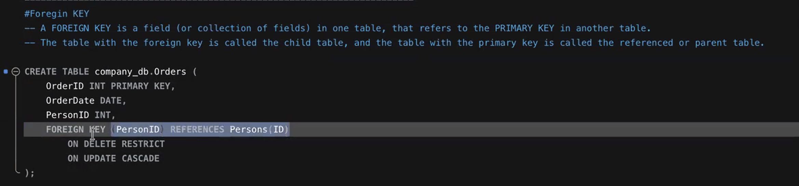

**Unique constraint** - ensures that all values in a column are unique.  
&emsp;ID int NOT NULL UNIQUE,

**Not Null constraint** - enforces a column to NOT accept NULL values.  
&emsp;ID int NOT NULL,

**Check Constraint** - Permits operation only if values in a column satisfies a specific condition  
&emsp;Age int CHECK(Age>=18)  
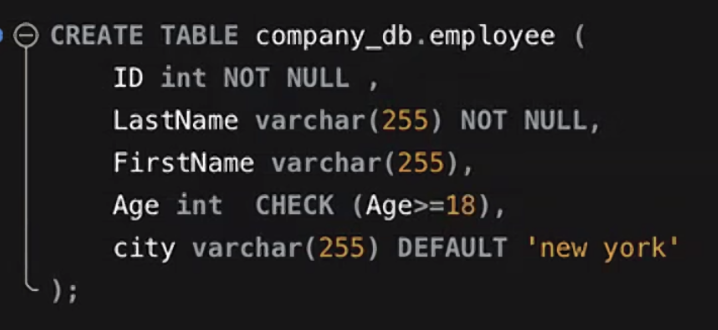

**Default Constraints** - automatically insert a default value for a column, if no value is specified.  
&emsp;City varchar (255) DEFAULT 'San Fransisco'

### Composite Primary Key  
Combination of two or more columns as the primary key  
### Star Schema  
One parent linked to multiple child tables  
### Snowflake Scheme  
One parent connects to multiple child tables, and each child table also has grandchildren tables  
### Delete  
Delete specific rows from a table while keeping the table structure intact.  
### Truncate  
Delete the data in the table but retain the table.  
&emsp;TRUNCATE TABLE table_name;  
**Drop** - Drops / deletes the entire table, its structure, schema, and all data permanently from the database.  also can frop the entire database.  
&emsp;DROP TABLE IF EXISTS table_name;  
&emsp;DROP DATABASE databasename;  

**Creating a Database** - CREATE DATABASE database_name  
**Selecting that database to create tables in** - USE database_name

## 10/29/2026 - Day 03

### SELECT statement   
SELECT * FROM database_name.table.name; - Selects all data from the specified table in the specified database  
SELECT DISTINCT - Selects distinct values only  
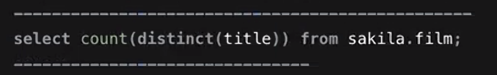  
Above code displays the total distinct film titles from Sakila db.  

### WHERE condition  
Filter out based on certain conditions.  
It can be chained with multiple AND / OR conditions.  
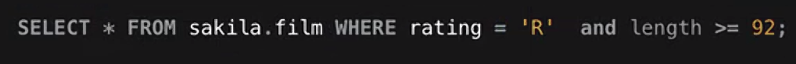  
The above code displays all the film titles that have an R rating and are longer than or equalt to 92 minutes of runtime.  

### LIMIT
Limits the number of output rows / records  

Ex: Finds the top 3 highest-paid employees  
SELECT name, salary  
FROM employees  
ORDER BY salary DESC  
LIMIT 3;  

### ORDER BY  
Order the returned records in ascending / descending order - sorts ascending if not specified.  

ORDER BY title desc; -- descending order  

### AND / OR Condition  
Returns tables only when either of (OR) / or both (AND) the conditions are satisfied.  

WHERE condition1 and condition2;  
WHERE condition1 or condition2;  

### NOT EQUAL TO !-

WHERE condition != value;  
WHERE NOT condition = value;  

WHERE condition NOT IN (value1, value2, value3);  
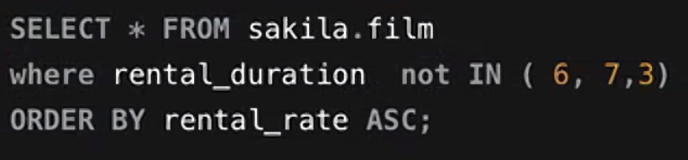  

### LIKE filtering  
Used when searching for data with a specific pattern.  
1. Percentile filtering  
2. Underscore filtering  

***Percentile filtering*** is used when the exact position is not known.  

WHERE city LIKE '%a'; - returns all the rows that end with 'a'.  

WHERE city LIKE '%ar%'; - returns all the rows that contain 'ar' - can be at the beginning, middle, or end with the pattern.  

***Underscore filtering*** is used when the index position for the pattern is known.  

WHERE city LIKE '_a___s%'; - returns all the rows that have the 2nd character as 'a' and the fifth as 's'.  
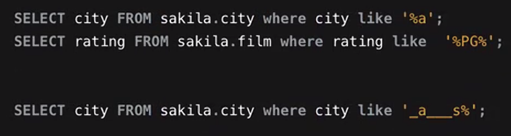  

### IS NULL  
WHERE columnName IS NULL;  

### Between  
WHERE columnName BETWEEN 'value1' and 'value2';  

### GROUP BY and HAVING  
GROUP BY is used as an aggregation function - it *groups* the data together for analysis.  
HAVING is then used as a condition inside that aggregation function.  
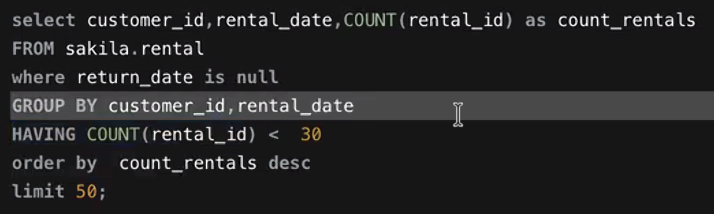  

Difference between WHERE and HAVING, since both are filtering based on a condition, on a structural level, is that HAVING filters after aggregation is done, whereas WHERE is before any aggregation is performed, i.e., on the row level.

### Order of execution  
FROM -> JOIN -> WHERE -> GROUP BY -> HAVING -> SELECT -> ORDER -> LIMIT  

***Query execution plan -- Read***

***Also read about the ALIAS Problem with SQL***  

## 10/30/2026 - Day 04

### Cardinality Relationships  
1. One-One relationship - One record of table 1 maps to exactly one record of table 2.  
2. One-Many relationship - One record of table 1 maps to multiple records of table 2.  
3. Many-One relationship - Many records of table 1 map to one record of Table 2.
4. Many-Many relationship - Many records of table 1 map to multiple records of table 2.  

**Bridge Table** - An intermediate table that is used to connect tables to themselves.  

### Joins  
In essence, connecting two tables in different ways for analysis.  
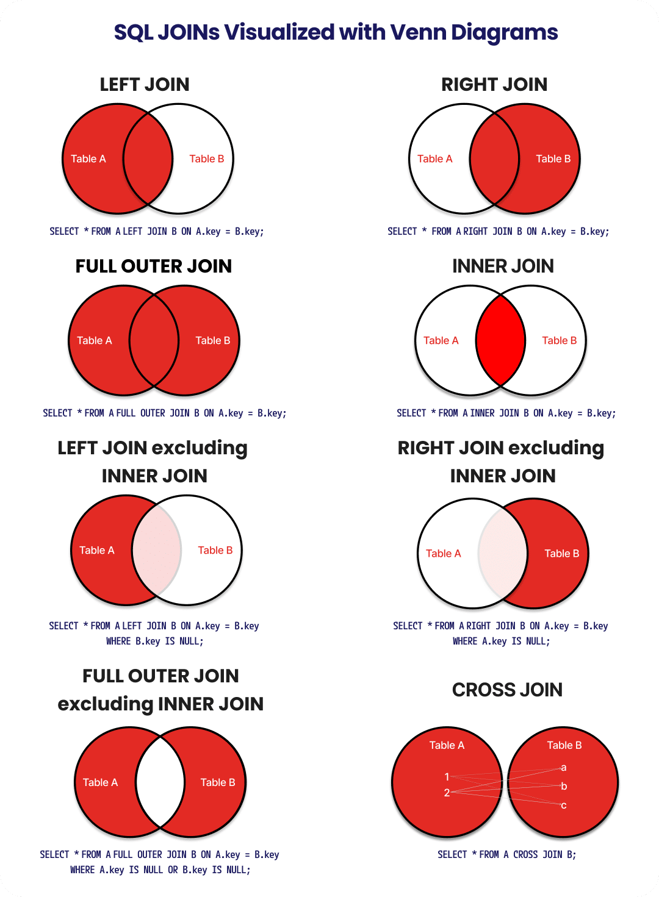   

1. **Left Join** - All the content of table A and the common content of table B.  
2. **Right Join** - All the content of table B and the common content of table A.  
3. **Full outer join** - All the content of table A and table B including the common ones.  
4. **Inner join** - just the common elements of Table A and B.  
5. **Left join excluding inner join** - All the elements of table A that are unique to it - no common elements from table B.  
6. **Right join excluding inner join / RIGHT ANTI** - Like the above, but for table B.  
7. **Full outer join excluding inner join / LEFT ANTI** - Just the unique elements from table A and table B, without the common ones.  
8. **Cross join** - combinations of all the elements of table A and table B where each item in table A maps with each item in table B - Also called a **Cartesian Product**  
9. **Self join** - Table joining with itself.  

Refer to the joins.sql file for more info with examples. Below table is used in those examples.  

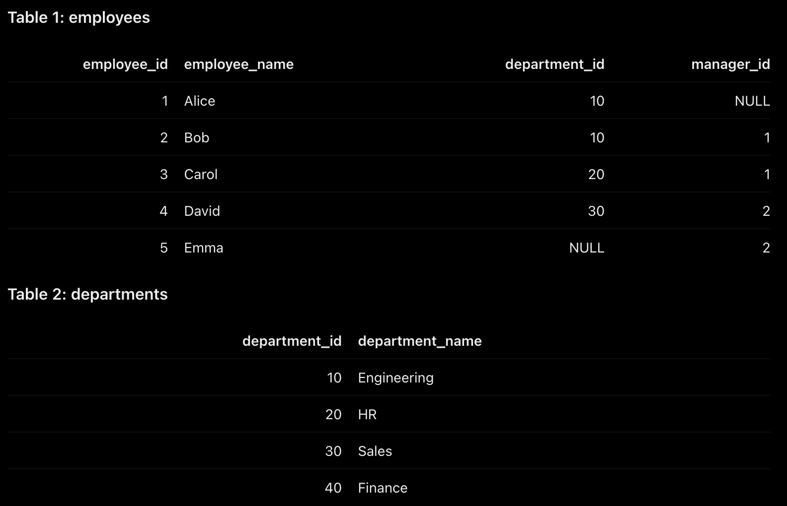