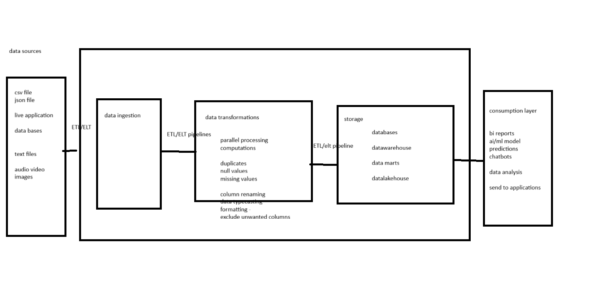
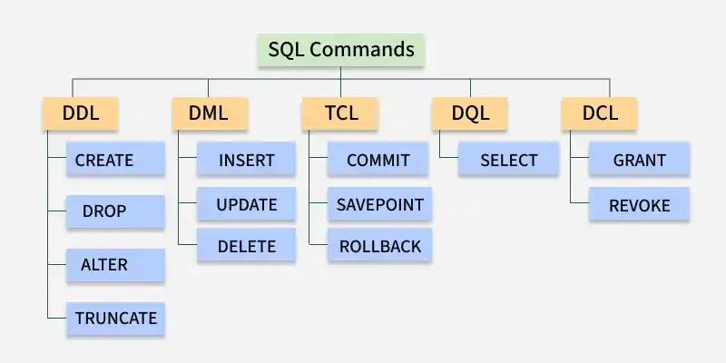
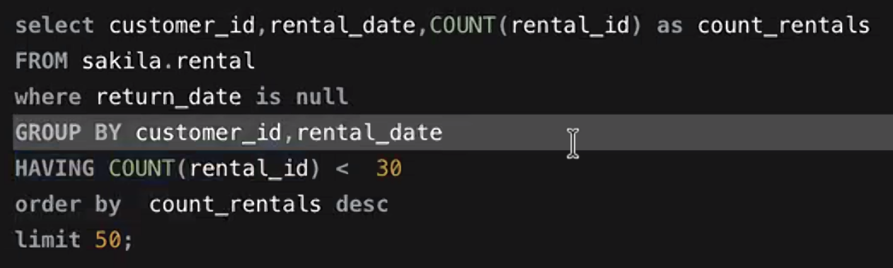
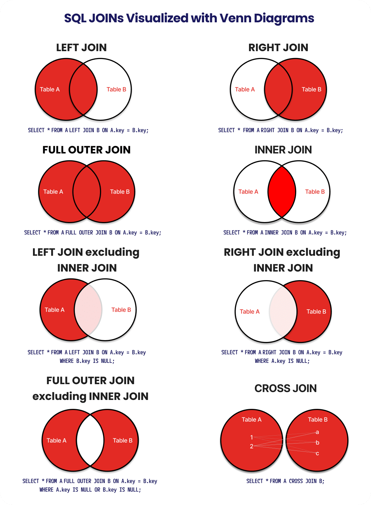
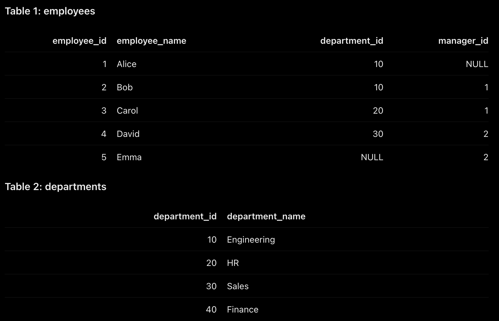

# 10/23/2026 - Day 01

## What is Data?
Unstructured collection of raw numbers, facts, figures, etc.

## What is information?
Simply put, it's Data with added insights / context.
- Data Collection
- Data Processing - to add context to the data - gain knowledge about it
- Identify patterns and make decisions based on those patterns

Data comes in three forms:
1. Structured data - data that has a schema defines - CSV, tables, etc.
2. Semi-structured data - data structured like a JSON - Web API calls, Key-value pairs, etc.
3. Unstructured data - Images, Video, PDFs, Docs, etc.

Stream Processing - Live data collection.  
Batch Processing - Collect and process data in batches - hourly / daily / weekly etc.

## Data sources
Data ingestion - Fetching data using ETL pipelines - On prem and On-Cloud

On-prem - host tool on self servers - you are responsible for orchestration, maintenance, etc.
Cloud - maintenance is taken care of by the cloud provider - AWS Glue, Azure Synapse, Informatica, etc. - Pay-as-you-go pricing

ETL has three layers: Bronze, Gold and Silver. More on that in a bit.

Bronze Layer - This is where the raw data (absolute source of truth) lives.

Where is data stored?
1. Structured data - Databases, MySQL, PostgreSQL, etc.
2. Semi-structured data - Cassandra, MongoBD, etc.,
3. Unstructured data - Dumped in Data lakehouses - Azure Blob, AWS S3 buckets, etc.

## Databases vs Data warehouses vs Data Marts
- Databases - smaller storage limits - uses internal server storage and memory
- Data warehouses - higher limits - scaling up databases when needed - here is where distributed systems and parallel processing come into view
- Data marts - a subset of data warehouses - eg. one for each department.

Silver Layer - Process the data from bronze layer - transformation of data happens here  
Gold layer - Apply business logic to silver data - consumption layer

ETL vs ELT which one to use and when? depends on the infrastructure / architecture - on premise or cloud?  

**Data Orchestration pipeline:** the whole Data collection, transformation and storage from the above figure.
- Scheduling: Stream processing / batch processing - pipelines don't need to be run manually, they can be automated
- Logging - error logs, failure logs, etc.  

**Note here:** There has been a substantial overview of the Consumption layer but my ADHD resulted in me not listening to most of it, I'll have to infer from future notes and edit that here in retrospect.  
We spoke about AI/ML models a bit, where Data Analysts come in, where Data Engineers come in, and where Data Scientists slot in.

# 10/28/2026 - Day 02

**SQL** - Structured Query Language - used to store structured data - tables  
**DB** - An organized collection of data saved on a computer  
**MySQL Server** - RDBMS that stores, organizes, and manages data using SQL  
**MySQL WorkBench** - Tool for managing and working with MySQL databases  

  

**DDL** - Data Definition Language - used to define data - CREATE / ALTER / TRUNCATE / DROP  
**DQL** - Data Query Language - SELECT statement  
**DML** - Data Manipulation Language - manipulate existing data on the table  
**DCL** - Data Control Language - GRANT, CONTROL, DENY - Define roles to people for access

**Create a database**  

    CREATE DATABASE company_db;

**Create a table** -  

    CREATE TABLE company_db.test_table 
    {
        id INT,
        name varchar (100)
    }

**Select and insert** -   

    SELECT id FROM company_db.test_table  
    INSERT INTO company_db.test_table(id, name)  
    VALUES  
    (1, 'A'),  
    (2, 'B'),  
    (3, 'C');

**ALTER** - used to add, delete, or modify columns in an existing table  

    ALTER TABLE company_db.test_table  
    ADD EMAIL varchar (255); - Add columns

    ALTER TABLE company_db.test_table  
    RENAME COLUMN email to email_id - Change column names

**De-normalization** - combine tables into one - used while working with schemas while creating data warehouses - to reduce duplication.  
## Constraints
Rules enforced on a table's columns to restrict the type of data that can be inserted, updated, or stored.  
Used to prevent insertion of invalid data in a table.

Can be applied in **two** ways - while **creating** the database, or while **altering** the database.
1. Primary Key
2. Foreign Key
3. Not Null
4. Default
5. Check

**Primary Key** - Unique column that is not null - to be able to identify and connect tables  
**Foreign Key** - A column in the child table that links back to a parent key - used to connect tables - a table can have multiple foreign keys

**Parent table** is called the **Referenced table**.  
**Child table** is called the **Referencing table**

**ON UPDATE CASCADE** - Parent update - Updating parent also updates child record.  
**ON DELETE RESTRICT** - Parent delete - Restricts deleting parent record before deleting child parent.  
 

    CREATE TABLE company_db.Orders (
        Order_id INT PRIMARY KEY
        Order_date DATE
        Customer_ID INT
        FOREIGN KEY (Customer_ID) REFERENCES customer(Customer_ID)
        ON UPDATE CASCADE
        ON DELETE RESTRICT
    )

**Unique constraint** - ensures that all values in a column are unique.  
    
    ID int NOT NULL UNIQUE,

**Not Null constraint** - enforces a column to NOT accept NULL values.  

    ID int NOT NULL,

**Check Constraint** - Permits operation only if values in a column satisfies a specific condition.

    AGE INT CHECK (Age >=18)
    CITY VARCHAR(255) DEFAULT 'SAN FRANSISCO'

**Default Constraints** - automatically insert a default value for a column, if no value is specified.  

    city varchar (255) DEFAULT 'San Fransisco'

## Composite Primary Key  
Combination of two or more columns as the primary key  
## Star Schema  
One parent linked to multiple child tables  
## Snowflake Scheme  
One parent connects to multiple child tables, and each child table also has grandchildren tables  
## Delete  
Delete specific rows from a table while keeping the table structure intact.  
## Truncate  
Delete the data in the table but retain the table.  

    TRUNCATE TABLE table_name;  

**Drop** - Drops / deletes the entire table, its structure, schema, and all data permanently from the database.  also can frop the entire database.  

    DROP TABLE IF EXISTS table_name;  
    
    DROP DATABASE databasename;  

**Creating a Database**  

    CREATE DATABASE database_name

**Selecting that database to create tables in**  

    USE database_name

# 10/29/2026 - Day 03

## SELECT statement  
Selects all data from the specified table in the specified database

    SELECT * FROM database_name.table.name;

Selects distinct values only

    SELECT DISTINCT  

Count distinct gives out the total number of items from a database.

    SELECT count(distinct(title)) from sakila.film;

## WHERE condition  
Filter out based on certain conditions.  
It can be chained with multiple AND / OR conditions.  
    
    WHERE rating = 'R' AND length >= 92;  

The above code displays all the film titles that have an R rating and are longer than or equalt to 92 minutes of runtime.  

## LIMIT
Limits the number of output rows / records  

Ex: Finds the top 3 highest-paid employees  

    SELECT name, salary  
    FROM employees  
    ORDER BY salary DESC  
    LIMIT 3;  

## ORDER BY  
Order the returned records in ascending / descending order - sorts ascending if not specified.  

    ORDER BY title desc; -- descending order  

## AND / OR Condition  
Returns tables only when either of (OR) / or both (AND) the conditions are satisfied.  

    WHERE condition1 and condition2;  
    WHERE condition1 or condition2;  

## NOT EQUAL TO !-

    WHERE condition != value;  
    WHERE NOT condition = value;  

    WHERE condition NOT IN (value1, value2, value3);  

## LIKE filtering  
Used when searching for data with a specific pattern.  
1. Percentile filtering  
2. Underscore filtering  

***Percentile filtering*** is used when the exact position is not known.  

WHERE city LIKE '%a'; - returns all the rows that end with 'a'.  

    WHERE city LIKE '%ar%';  
returns all the rows that contain 'ar' - can be at the beginning, middle, or end with the pattern.  

***Underscore filtering*** is used when the index position for the pattern is known.  

    WHERE city LIKE '_a___s%';  
- returns all the rows that have the 2nd character as 'a' and the fifth as 's'.  

## IS NULL  
    WHERE columnName IS NULL;  

## Between  
    WHERE columnName BETWEEN 'value1' and 'value2';  

## GROUP BY and HAVING  
GROUP BY is used as an aggregation function - it *groups* the data together for analysis.  
HAVING is then used as a condition inside that aggregation function.  
  

Difference between WHERE and HAVING, since both are filtering based on a condition, on a structural level, is that HAVING filters after aggregation is done, whereas WHERE is before any aggregation is performed, i.e., on the row level.

## Order of execution  
FROM -> JOIN -> WHERE -> GROUP BY -> HAVING -> SELECT -> ORDER -> LIMIT  

***Query execution plan -- Read***

***Also read about the ALIAS Problem with SQL***  

# 10/30/2026 - Day 04

## Cardinality Relationships  
1. One-One relationship - One record of table 1 maps to exactly one record of table 2.  
2. One-Many relationship - One record of table 1 maps to multiple records of table 2.  
3. Many-One relationship - Many records of table 1 map to one record of Table 2.
4. Many-Many relationship - Many records of table 1 map to multiple records of table 2.  

**Bridge Table** - An intermediate table that is used to connect tables to themselves.  

## Joins  
In essence, connecting two tables in different ways for analysis.  
   

1. **Left Join** - All the content of table A and the common content of table B.  
2. **Right Join** - All the content of table B and the common content of table A.  
3. **Full outer join** - All the content of table A and table B including the common ones.  
4. **Inner join** - just the common elements of Table A and B.  
5. **Left join excluding inner join** - All the elements of table A that are unique to it - no common elements from table B.  
6. **Right join excluding inner join / RIGHT ANTI** - Like the above, but for table B.  
7. **Full outer join excluding inner join / LEFT ANTI** - Just the unique elements from table A and table B, without the common ones.  
8. **Cross join** - combinations of all the elements of table A and table B where each item in table A maps with each item in table B - Also called a **Cartesian Product**  
9. **Self join** - Table joining with itself.  

Refer to the joins.sql file for more info with examples. Below table is used in those examples.  

  

# 11/02/2026 - Day 05

## Sub-Query - this section will be refined later

Essentially a Query within a query - can be used to combine two queries into one nested query.

Sub-queries can be used in:  
1. SELECT statement
2. WHERE clause
3. FROM claude - Derived tables  

**Correlated Queries** - When an outer table is referenced inside a child table.

When to use Join and when to use a Sub Query  

Using Sub query as an Alias  

Derived table scope of execution only at query level  
Correlated sub-query  

When using sub-query in select statement, it should be limited to 1 value 

# 11/03/2026 - Day 06  

## CTE - Common Table Expression  

Think of it as declaring the content of a sub query beforehand and referencing it in the actual query.  

Helps with readability and re-usability, but does not help with scope - still scoped at Query level.  

    WITH cte_name AS   
    (  
        SELECT column1, column2  
        FROM table_name  
        WHERE condition  
    )  
    SELECT * FROM cte_name;  

Always followed with a SELECT statement, filter, join, group, aggregate, etc.. to select the result of the CTE and perform stuff on it.  
1. with starts the CTE definition and cte-name is the name assigned to the result.  
2. cte_name is the name assigned to the result.  
3. AS introduces the query that produces the result.  
4. (select...) the actual query that produces the result - the query inside parantheses.  
5. Outer SELECT uses the CTE as the source of data.  

Ex: identify customers who have rented more than five films.  
  
    SELECT customer_id, COUNT(rental_id) AS total_rentals
    FROM rental
    GROUP BY customer_id
    WHERE count(rental_id) > 5;  

The above returns it just fine, but what if you want to use this result in another query? You use a Sub-query...

OR..  

You can use a CTE.

    WITH cte_name AS
    (
        SELECT
            customer_id,
            COUNT(rental_id) AS total_rentals
        FROM rental
        GROUP BY customer_id
    )
    SELECT *
    FROM cte_name
    WHERE total_rentals > 5;

1. WITH tells MySQL that you are defining a CTE.  
2. customer_rentals is the name you have given it.  
3. AS introduces the query that generates its data.  
4. The query inside the parentheses retrieves the rental count for each customer.  
5. The outer SELECT reads the result using the name customer_rentals.  

**CTE does not create a permanent table - it only exists inside the statement - SCOPE.** 

## Recursive CTE  

CTE that calls itself - used for running a CTE multiple times - think printing first n numbers in python (example, not to scale)  

    WITH RECURSIVE cte_name AS  
    (  
        --anchor member - runs once - initiates the first number - the starting point of the recursion  
        
    UNION ALL  

    --recursive member - runs repeatedly - references cte_name  
    )  

Refer to the separate sql scripts for CTEs for more info (not yet added - will be added shortly)  

# 11/04/2026 - Day 07  

## Temp Tables  

Think of them as tables created to hold data temporarily while we work on them.  
Like a scratchpad.  

**Two ways to create temp tables**  
1. SELECT statement.  
2. Create structure first, insert data later  

## Temp-Tables using SELECT

    CREATE TEMPORARY TABLE temp_table_name AS

    SELECT ....  

What you're essentially asking here is to create a temporary table with the name temp_table_name, and use the content following the select statement to populate it.  

## Creating Temp-table structure first - insert data later  

    CREATE TEMPORARY TABLE table_name (  
        customer_id INT,  
        first_name VARCHAR(50),  
        last_name VARCHAR(50)  
    )  

This creates the structure for the temporary table, which can then be populated.  

INSERT INTO table_name  

    SELECT ...  

## Limitations of Temp-Tables  
**Temp tables are persistent to session level**  i.e., other database sessions cannot access them.  

Disappear when the session closes.  

## When to use Temp tables  
1. Complex data transformation - save immediate result and perform additional transformations.  
2. Multiple calculations on the same result.  
3. Data cleaning / ETL - use as a staging table to clean, transform and validate results before loading them in a permanent table  

# 11/05/2026 - Day 08  

## Views  
Think of it like a saved SQL query that behaves like a virtual table.  

It does not exist like a separate table, but only does so when the view is called.

    CREATE OR REPLACE VIEW view_table AS  

    SELECT ...  
    FROM ...  
    WHERE ...  

The above creates a view and saves it as the SQL query, NOT a table - REMEMBER  

**The table is executed ONLY when the view is called.**  

    SELECT * from view_table;  

You can perform almost any action you want on the view table, treating it like an actual table.  

It does not store any data, it executes the saved query everytime the view is called.  

**Modifying an existing view definition**  

    ALTER VIEW view_table AS  

The CREATE OR REPLACE VIEW can also be used to replace its definition after creating.  

    DROP VIEW view_table  

drop the view - DOES NOT delete the records - only deletes the saved query  

**Read about the WITH CHECK option**  

**Scope of View table** - larger  - not session specific - survives restarts, disconnects, etc.  

## Limitations  
1. No independent data storage  
2. Dependency - dropping / changing underlying tables can break views  

## When to use Views  
1. Repeated reporting  
2. Data abstraction - only expose certain columns instead of entire tables  

## Stored Procedures  

Named collection of SQL statements stored inside the database to be executed on call.  

## Delimiter  
Use this at the starting and ending of a stored procedure to let SQL know whatever inside it should be treated as one SQL query.

    DELIMITER //  

    stored procedure query  

    DELIMITER ;  

Why? - because a stored procedure has multiple SQL queries so MySQL doesn't know where to stop executing.

## Syntax  

    DELIMITER //

    CREATE PROCEDURE procedure_name()

    BEGIN

    SELECT *
    FROM table_name;

    END //

    DELIMITER ;  
Begin marks the beginning of the stored procedure.  
End marks the end of the stored procedure.  

## Calling the stored procedure  
    CALL procedure_name();  

## Parameters in stored procedures  

Essentially a value that can be used to prevent using hardcoded values in a stored procedure so the same stored procedure can be used for multiple values.  

    DELIMITER //

    CREATE PROCEDURE procedure_name(
        IN sp_customer_id INT
    )

    BEGIN
        SELECT *
        FROM customer
        WHERE customer_id = sp_customer_id;
    END

    DELIMITER ;
Try to read that step by step.  
1. We create a stored procedure called procedure name.  
2. It accepts an INT value sp_customer_id.  
3. IN means the procedure recieves a value from the calling function -- INPUT parameter -- discussed below  
4. That value is then used inside the BEGIN query and is returned.  

Now the function can be called with a value inside paranthesis like:  

    CALL procedure_name(2);

That executes this:  

    SELECT * FROM customer WHERE customer_id = 2;

## Types of parameters
1. IN - input parameter
2. OUT - output parameter
3. INOUT - takes an output parameter and uses it as an input parameter (iterative)  

**OUT parameter** - Allows the procedure to send a value BACK to the caller.  

Declare a procedure with an OUT statement, and then place values INTO that value in the stored procedure.  

    DELIMITER //

    CREATE PROCEDURE procedure_name (
        OUT output_param INT
    )

    BEGIN

    SELECT COUNT(*)
    INTO output_param
    FROM customer;

    END //

    DELIMITER;

The query above essentially declares an output parameter called "procedure_name" and then places the result of whatever is inside the begin statement into the output_param using

    INTO output_param

## How do you call an output parameter  

Create a **session variable**:  

    SET @total = 0;  

Now call the procedure:  

    CALL procedure_name(@total);  

Why does this alone not print a value? - because you are just calling a declared procedure and that procedure just stores data doesn't return anything.

Return the value of the procedure:

    SELECT @total;  

**INOUT parameter** - Does both essentially  

Recieves a value, modifies it and then returns it.  

    DELIMITER //

    CREATE PROCEDURE stored_procedure_name (
        INOUT random_value INT
    )

    BEGIN

    SET random_value = random_value * 2;

    END //

    DELIMITER

The above code returns twice of whatever value you give it.  

**Set a variable number**  

    SET @number = 5;

**Call it**

    CALL stored_procedure_name(@number);

**Return the value to view it**  

    SELECT @number;  

Returns 10.

## DECLARE

Declare creates a local variable.  

    DECLARE local_variable INT;

## SET
Set creates a session variable.  

    SET @total = 0;

## SELECT INTO
Retrieves the value and stores it in a variable.  

## Show procedures in current database

    SHOW PROCEDURE STATUS
    WHERE Db = DATABASE();

## Limitations of Stored Procedures
1. database dependency
2. debugging convenience
3. permissions - users need appropriate permissions to create or execute stored procedures  

**They are NOT any faster than ordinary SQL queries.** They're main advantage is reusable database logic.

## Drop a Procedure  
    DROP PROCEDURE IF EXISTS procedure_name;

## Dynamic SQL  

Constructing a SQL statement as text and executing it at runtime.  

Stattic SQL - everything defined at the time of defining the query.

    SELECT * FROM customer_table
    WHERE customer_name LIKE 'RAGHAV';

Dynamic SQL works differently, you first define a variable.  

    SET @variable_name = 'customer';

What we did above was essentially assign the customer table a variable name so we can use it.  

Now to construct the query.  

    SET @dynamic_query_name = CONCAT(
        'SELECT * FROM ', variable_name
    );

It **concatenates** (combines strings) the select statement with whatever variable name we give.  

Becomes  

    SELECT * FROM customer;

**Creating a dynamic query just creates it, doesn't execute it.** For that we use these:  

1. PREPARE
2. EXECUTE
3. DEALLOCATE

**PREPARE** - Prepares for the execution of the dynamic query  

    PREPARE stmt FROM @dynamic_query_name;  

**EXECUTE** - Execute the prepared statement

    EXECUTE stmt;  

**DEALLOCATE** - Clean up - releases the prepared statement  

    DEALLOCATE PREPARE stmt;  

**Remember** - You set the variable first, use that variable in the dynamic query, and then prepare - execute - deallocate as needed.  

**Placeholders in Dynamic SQL**  

A placeholder can be used instead of concat.  

    SET @dynamic_query_name = '
        SELECT * FROM customer
        WHERE customer_id = ?
    ';  

Now this ? can be set at runtime after preparing the stmt.  

    PREPARE stmt FROM @dynamic_query_name;  

Then set the value for ?  

    SET @customer_id = 5;

Notice how you used set AFTER you declared the statement.  

    EXECUTE stmt USING @customer_id;  

basically asking sql to execute the dynamic query by using the variable name you set.  

    DEALLOCATE PREPARE stmt;  

**? can only be used for data values, not table_names or column names or SQL keywords like WHERE, SELECT or GROUP BY  

Use **String Construction (from above)** if you want to use dynamic table names.  

## Dynamic SQL Procedures  

    DELIMITER //

    CREATE PROCEDURE procedure_name(
        IN table_name VARCHAR(50)  -- takes a table name as an input for the stored query
    )

    BEGIN

        SET @dynamic_query_name = CONCAT(
            'SELECT * FROM ', table_name -- uses the above input table_name
        )
    
    PREPARE stmt FROM @dynamic_query_name -- prepare statement from the dynamic query

    EXECUTE stmt; -- execute the prepared statement

    DEALLOCATE PREPARE stmt; -- deallocate once it runs

    END

    DELIMITER //  

Call the procedure.  

CALL procedure_name('customer);  

**USE ALLOW LISTS TO PREVENT SQL INJECTION**

Essentially, you are allowing only certain values to be injected into the query, and not destructive values like DROP TABLE table_name, etc..  

    IF procedure_name NOT IN(
        'customer',
        'rental',
        'payment'
    )

    THEN

    SIGNAL SQLSTATE '45000'
    SET MESSAGE_TEXT = 'Invalid table name';

    END IF;

Adding the above code block inside the stored procedure, immediately after BEGIN will make sure any other input outside of the ones specified will return an error 'Invalid table name'.  

## When to use what - Temp Table, View, Stored procedure, Dynamic SQL - and why:  

1. **Store immediate result for multiple queries** - Temp table - stores actual data for the time being.
2. **Save a complex JOIN query for repeated reporting** - View - Saves the query definition to rerun when needed.
3. **Execute multiple SQL statements with one command** - Stored Procedure - Groups SQL instructions under one delimiter block.
4. **Accept different parameters as input - Stored procedure** - accepts parameters.
5. **Different tables based on user input - Dynamic SQL** - SQL structure changes at runtime.
6. **Expose select columns for analysis - Views** - support abstraction
7. **Stage and transform data during ETL - Temp tables** - holds immediate data physically but not permanently.  

# 11/07/2026 - Day 09

## Indexes

Think of this as a method how databases find data quickly instead of searching every row.  

**Full Table Scan** - When MySQL inspects every row in the table to find the relevant rows.  

- Table stores data
- Index stores organized structure to help locate the data - contains indexed column.  

## Creating an Index:  
    CREATE INDEX index_name
    ON table_name(column_name);  

## Creating an index while creating a table:  
    CREATE TABLE table_name (
        table_id INT PRIMARY KEY,
        column_1 VARCHAR(50),
        column_2 VARCHAR(50),
        INDEX index_name(column_2)
    )

Notice how we define the column first and then assign it an index.  

## Check indexes on a table  
    SHOW INDEXES FROM table_name;

## Deleting an index:  
    DROP INDEX index_name
    ON table_name;

## Types of indexes:  
1. Clustered Index
2. Non Clustered Index

## Clustered Index  

Essentially an index that defines how the data rows are ordered in a table.  

A table can have only one clustered index, as the data can only be physically arranged in one way or the other.  

Think of it like sorting physicals books on a rack. You can arrange them in anyway, but only in one order at a time. Alphabetical or whatever.  

Usually the primary key of the table is the Clustered Index.

Clustered Index contains the actual row data, not just references to it.

Ex: Primary Key

## Non-clustered Index

Maintained separately from the actual table.  

Creating a secondary index allows searching based on that index.

Stores only the index values and primary key values.  
We can create multiple secondary / non-clustered indexes on a table.  

Ex: Index on last_name  

## Primary Key Index  

Created when we define a primary key.  

## Unique Index  

Ensures the indexed value or combination cannot be duplicated.  

    CREATE UNIQUE INDEX index_name
    ON table_name(column_name);

Prevents two rows from having the same data in its column_name  

## Regular Index
Allows duplicate values  

    CREATE INDEX index_name
    ON table_name(column_name);  

## Composite Index  
Index built using multiple colums.  

    CREATE INDEX index_name
    ON table_name(column_name1, column_name2); 

**Primary Key vs Clustered Index vs Secondary Index** - READ

## Natural Key & Surrogate key  
Essentially types of primary keys - comes up in Database Design.  

## Natural Keys  
Basically something we naturally wanted to store.  

For example, USERNAME or EMAIL in the user table - they are naturally unique and something that is not added ***just*** to have a primary key.  

## Surrogate key  

Something that is added to the table just to have a primary key. It doesn't have a real world meaning, like USERNAME or EMAIL had.  

Does not add any valuable *information* to the table.  

It has a feature called **AUTO-INCREMENT**  

Think customer_ID in a customer table. It has no real-world meaning outside of that database, and it exists purely to make the data in the table unique.  

    CREATE TABLE customers (
        customer_ID INT AUTO_INCREMENT PRIMARY KEY,
        first_name VARCHAR(50),
        last_name VARCHAR(50),
        email VARCHAR(255)
    );

Notice how we gave an auto-increment for the primary key?  

Now when entering information into the table MySQL automatically creates the customer_ID and increments it for every entry without me having to enter it.  

    INSERT INTO customers (first_name, last_name, email)
    VALUES
    ('John', 'Doe', 'john@example.com'),
    ('Jane','Smith','jane@example.com');  

## Composite Key  

Uses multiple columns to id a row uniquely.  

Say we have a table that maps out the students and the courses they are enrolled in.  
Student_ID is the primary key for the student table, and course_ID the primary key for the courses table so neither are unique.  

Now, we can use a combination of student_id and course_id to uniquely id the rows since the combination is unique to each row.

    CREATE TABLE student_courses (
        student_id INT,
        course_id INT,
        PRIMARY KEY (student_id, course_id)
    );

# 11/8/2026 - Day 10  

## Window Functions  

Performs a calculation across related rows WHILE preserving each individual rows.  

### Syntax

    SELECT column_name,
        WINDOW_FUNCTION() OVER (
            PARTITION BY column_name
            ORDER BY column_name
        )
    FROM table_name;  

WINDOW_FUNCTION() OVER - actual function you want to use.  

OVER tells MySQL to use the function as a window function and not an aggregate function.  

The different types of window functions include:  

1. ROW_NUMBER()
2. RANK()
3. DENSE_RANK()
4. SUM()
5. AVG()
6. LAG()
7. LEAD()  

PARTITION BY - Partition at the group level - divides data into groups for calculation.  

ORDER BY - determines the order in which the rows are considered inside the window function.

Think of Partition by essentially as GROUP BY but does not provide just the aggregated value but along with it also the original data.  

    SELECT 
        rental_id,
        rental_date,
        customer_id,
        COUNT(*) OVER (
            PARTITION BY customer_id
        ) AS total_rentals
    FROM rentals;

Try to analyze the above code. It basically returns the total number of rentals each customer made, just like GROUP BY would.  

The difference?  

It shows that aggregated value ALONGSIDE the original rental row.  

Whereas GROUP BY would've tossed an error because rental_id cannot be printed when there is an aggregate function because it groups the customers and each customer can have multiple rental_ids.  

ROW_NUMBER() - Assigns a sequential number to each row within a window.  

    ROW NUMBER() OVER (
        PARTITION BY column_id
        ORDER BY column_name
    )

## Optimization Techniques  
1. Use only necessary culmns in SELECT statement.  
2. Use WHERE before GROUP BY and HAVING - filtering ALWAYS before aggregation - less extensive  
3. Prefer JOINS to Subqueries  
4. Avoid functions on Indexed columns  
5. use LIMIT effectively - limits the number of returned rows - less computationally extensive
6. Prefer CTEs to Sub-Query  
7. Run *maintenance* commands regularly.  

    ANALYZE table table_name;  
    OPTIMIZE table table_name;
8. Avoid large offsets in Pagination.